# Clawd Crab for T3 Code

Animated pixel Clawd for [T3 Code](https://github.com/pingdotgg/t3code). It plays a different animation for each state your agent is in.

Built on top of **[t3-clawd](https://github.com/rohit3a/t3-clawd) by [@rohit3a](https://github.com/rohit3a)**. That theme gives T3 Code its Claude Code look, and this repo adds the crab. It's still Claude Code, just crab-themed. 🟧

> **v1 beta.** It has only been tested against T3 Code's source and in a headless browser that copies its DOM, not in a long session in the real app yet. If a crab ends up in the wrong place, please [open an issue](../../issues) with a screenshot.

## The crabs

| | | | |
| :---: | :---: | :---: | :---: |
| <br>**Idle**<br><sub>breathes, blinks</sub> | <br>**Thinking**<br><sub>✻ spinner, eyes looking around</sub> | <br>**Working**<br><sub>hammers the keyboard, code flies out</sub> | 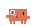<br>**Reading**<br><sub>magnifier sweeps the files</sub> |
| <br>**Delegating**<br><sub>flings out mini subagent crabs</sub> | <br>**Subagent**<br><sub>a mini crab, scuttling</sub> | 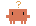<br>**Waiting**<br><sub>waves, holds up a “?”</sub> | <br>**Error**<br><sub>flashes red, X eyes, sweats</sub> |
| <br>**Done**<br><sub>happy hop, sparkles</sub> | <br>**Sleeping**<br><sub>tucked legs, Zzz</sub> | <br>**Compacting**<br><sub>squeezes the conversation</sub> | <br>**Terminal**<br><sub>types a command, output scrolls in</sub> |
| <br>**Editing**<br><sub>snips the old line, a green one grows</sub> | <br>**Browsing**<br><sub>surfs the web, globe spinning</sub> | <br>**Planning**<br><sub>ticks off a checklist</sub> | 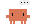<br>**Listening**<br><sub>watches you type, “…” bubble</sub> |

There are 16 crabs. Each one is a single SVG file between 0.7 and 2.4 KB. The animation is CSS inside the SVG, so there are no GIFs and no JavaScript. If your system is set to reduce motion, every crab holds still on its first frame. For a closer look, download [`clawd-gallery.html`](clawd-gallery.html) and open it in a browser. It shows each state next to a Claude Code-style status line.

## Where they show up

- **On the message box:** a big Clawd stands on top of the chat input and follows the open thread. It types while the agent works and thinks while it reasons. It reads during file reads and code searches, runs commands in a tiny terminal, snips code during edits, surfs during web searches, ticks off a checklist when the agent plans, and deploys mini crabs while subagents run. While you type a message, it watches you type. It waves for approvals, sweats on errors, celebrates when a turn ends, and eventually falls asleep.
- **Beside "Working for 12s":** a small typing crab, which switches to a squishing crab while the context is compacted.
- **Beside each running subagent:** a scuttling mini crab.
- **In an empty chat:** a mini crab walks back and forth along the top of the message box, towards the big Clawd.
- **In the sidebar:** each thread gets a crab for its status (working, waiting, error, done or asleep). It hides when you hover the row so the buttons stay clickable.

## How to install

You need **T3 Code nightly from 14 Nov 2026 or later**. Earlier versions cap theme CSS at 20,000 characters, and this theme uses about 47,300 (the current nightly allows 100,000).

### Option A: in the app (easiest)

1. Download **`t3-clawd-crab.json`** from the [latest release](../../releases), or [from this repo](t3-clawd-crab.json) using GitHub's **Download raw file** button.
2. In T3 Code, open **Settings → Appearance** and click **Add a theme**.
3. Drop the file in, or paste its contents into **Theme JSON**.
4. Pick **Clawd Crab**.

### Option B: from the terminal

```sh
t3 theme set ./t3-clawd-crab.json
```

This publishes the theme as `t3-clawd-crab` and makes it the default for this machine's T3 Code. Run `t3 theme clear` to undo it.

### Updating

To update, download the new `t3-clawd-crab.json` and add it the same way. It replaces the old one.

### Only want the sprites?

[`clawd/clawd-theme.css`](clawd/clawd-theme.css) contains just the 16 sprites as CSS variables (`--clawd-working` and the rest), so you can use them in your own theme:

```css
.my-thing { background: var(--clawd-working) center / contain no-repeat; }
```

[`clawd/clawd-mod.css`](clawd/clawd-mod.css) adds the rules that place the crabs, without the t3-clawd styling.

## Make it your own

Everything is generated by one script with no dependencies:

```sh
npm run build    # writes the SVGs, CSS, gallery and t3-clawd-crab.json
npm test         # checks the result (see below)
npm run preview  # writes mock-preview.html, a fake T3 Code with every state
```

| File | What it does |
| --- | --- |
| [`build.mjs`](build.mjs) | Draws every crab and animation as pixel art, then builds all the outputs |
| [`mod.template.css`](mod.template.css) | Where the crabs appear, their sizes, and which state wins |
| [`gallery.template.html`](gallery.template.html) | The gallery page |
| [`vendor/t3-clawd.json`](vendor/t3-clawd.json) | The original t3-clawd theme, unchanged |

Want a bigger crab? Change the `width`/`height` in `mod.template.css` (keep the mascot at about 0.72 × its width), then run `npm run build`.

## Tests

`npm test` runs 40 checks with Node's built-in test runner. There's nothing to install.

- **Theme file:** matches T3 Code's theme schema (name, colors, the 100k CSS limit), using rules copied from T3 Code's source.
- **No stripped styles:** T3 Code's own fetch filter (copied into `test/t3/`) accepts every sprite, and the CSS loads no remote files.
- **SVGs:** each one is self-contained, with no scripts and no external links, and safe to embed.
- **Build is current:** a fresh build matches the committed files exactly.
- **Real browser:** a headless Chrome or Edge loads a fake T3 Code DOM, applies the theme with T3 Code's own loader, and checks which crab appears in 26 situations. It covers every tool, typing a message, empty chats, every sidebar status, and the subagent and "Working…" rows. This test is skipped if no Chrome or Edge is found (set `CHROME_PATH` to point at one).

GitHub Actions runs the same tests on every push.

## How it works

T3 Code themes are CSS only and cannot load files. So:

- Every sprite is inlined as a `data:` URI in a CSS variable. Inlining is allowed, and each sprite costs about 1 KB.
- The CSS reads state from attributes T3 Code already renders. Examples are `data-timeline-row-kind="working"`, `data-v2-item-type="subagent"`, `aria-description="Running"`, the sidebar's `aria-label="Title, Waiting, Project"`, and the lucide icon of the tool running right now.
- `body:has(...)` rules set `--cn` (the current crab). They're wrapped in `:where()`, so later, more urgent states win: idle → working → thinking → editing / terminal / planning / reading / browsing → delegating → compacting → waiting → error. Typing a message overrides all of them.
- When nothing is happening, a 150-second CSS animation shows a short celebration, then idle, then sleep.

### Known limits

- Only the stable hooks T3 Code documents are guaranteed. The others (the tool icons, the `live-*` classes, the sidebar status words) may change in a T3 Code update. If they do, `npm test` still passes but the crab may fall back to idle. Please open an issue if that happens.
- The sidebar status matching uses English status words.
- Listening detects text in the message box by the absence of its placeholder (`.text-placeholder`). If that class is renamed, Clawd listens whenever the box is focused.
- Works on web and desktop. T3 Code mobile doesn't use themes.

## Credits

- **[rohit3a/t3-clawd](https://github.com/rohit3a/t3-clawd)** by [@rohit3a](https://github.com/rohit3a). The whole Claude Code look comes from this theme. It is included unchanged in `vendor/` under its [MIT license](vendor/LICENSE) and merged into `t3-clawd-crab.json`. The build changes one thing: it writes the ⌘N hint as `"⌘N"` instead of the escape `"\2318N"`, because T3 Code drops CSS values that contain a backslash. Go star it.
- **[xyc/plushie](https://github.com/xyc/plushie)**, the plush Clawd mod for Claude Code, inspired the idea of a Clawd for every state. No assets were taken from it; every sprite here is new pixel art.
- **[T3 Code](https://github.com/pingdotgg/t3code)** by T3 Tools Inc. The tests use copies of its theme CSS filter and loader ([MIT](test/t3/LICENSE)) so they check exactly what the app checks.
- **Clawd** is Anthropic's mascot. This is an unofficial fan project, not affiliated with Anthropic or T3 Tools. Claude is a trademark of Anthropic.

## License

[MIT](LICENSE). The bundled t3-clawd theme and T3 Code snippets keep their own MIT licenses ([vendor/LICENSE](vendor/LICENSE), [test/t3/LICENSE](test/t3/LICENSE)).
